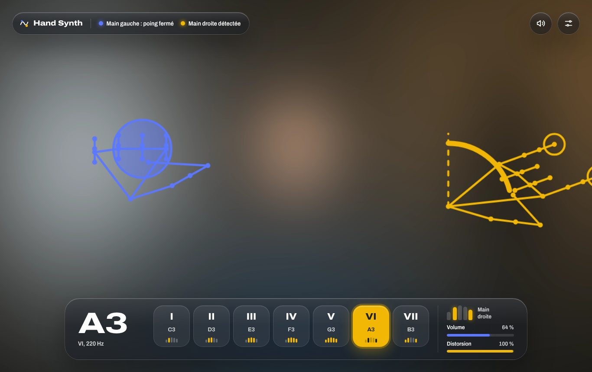

# Hand Synth

Un synthétiseur dont on joue avec les mains devant la webcam. La main droite
choisit la note avec les doigts et règle la distorsion en tournant le poignet.
La main gauche joue la note en fermant le poing, et règle le volume en montant
ou en descendant.

Tout tourne dans le navigateur : MediaPipe pour le suivi des mains, Web Audio
pour le son. Il n'y a ni serveur ni compte, et la vidéo ne quitte pas
l'appareil.

**Démo : https://br0man0.github.io/hand-synth/**



<sub>Capture faite avec une webcam et des mains simulées (test automatisé).</sub>

## Jouer en 30 secondes

1. Ouvre la démo (ou ta version locale), puis clique sur **Démarrer** et
   autorise la caméra.
2. **Main droite** : montre 1 à 5 doigts pour choisir les degrés I à V.
   Index et auriculaire donnent VI, avec le pouce en plus VII.
3. **Main gauche** : ferme le poing pour jouer, ouvre-le pour relâcher.
4. Poing fermé, **monte ou descends la main gauche** pour changer le volume.
5. **Tourne le poignet droit** comme un bouton pour ajouter de la distorsion.

| Main droite | Effet |
|---|---|
| 1, 2, 3, 4, 5 doigts tendus | Degrés I, II, III, IV, V |
| Index et auriculaire | VI |
| Index, auriculaire et pouce | VII |
| Tourner le poignet, dans un sens ou dans l'autre | Distorsion (rien jusqu'à 15°, maximum à 60°) |

| Main gauche | Effet |
|---|---|
| Fermer le poing | Joue la note choisie |
| Ouvrir la main | Relâche la note |
| Monter ou descendre, poing fermé | Volume, en continu |
| Hauteur au moment de fermer | Brillance de l'attaque |
| Changer de doigts à droite, poing fermé | Nouvelle note, sans relâcher |

Sans main gauche dans l'image, l'instrument se joue à une main : chaque
changement de doigts joue la note, et le poing droit la coupe. La touche
**M** coupe ou rétablit le son. Le bouton **Réglages**, en haut à droite,
ouvre la tonalité, la gamme, l'octave, la forme d'onde et les effets.

## Installer en local

```bash
git clone https://github.com/Br0man0/hand-synth.git
cd hand-synth
npm start            # puis ouvre http://localhost:5173
```

Il n'y a aucune dépendance à installer. Sans Node.js,
`python3 -m http.server 5173` fait aussi l'affaire. Pour les tests, le jeu sur
téléphone et le déploiement de ta propre copie, voir le
**[guide d'installation](docs/installation.md)**.

## Documentation

| Document | Contenu |
|---|---|
| [Installation](docs/installation.md) | Prérequis, lancement local, HTTPS pour téléphone, tests, déploiement de ta copie, mode hors ligne |
| [Fonctionnement](docs/fonctionnement.md) | Pipeline caméra → gestes → son, détection des doigts et du poing, logique de jeu, chaîne audio, interface |
| [Paramètres](docs/parametres.md) | Tout ce qui se règle : dans l'interface, et dans le code (son, gestes, réactivité, vision, apparence), avec valeurs par défaut et plages conseillées |
| [Dépannage](docs/depannage.md) | Caméra, détection, son, performances |
| [Design system](docs/design-system.md) | Matériau verre, tokens, composants, accessibilité |
| [ADR-0001](docs/adr/0001-stack-navigateur.md), [ADR-0002](docs/adr/0002-doigts-et-poing.md) | Décisions d'architecture et de gestes |

## Stack

- **Vision** : [MediaPipe Tasks Vision](https://ai.google.dev/edge/mediapipe/solutions/vision/hand_landmarker)
  `HandLandmarker` 0.10.35 (WASM, GPU avec repli CPU), 2 mains, 21 points par
  main.
- **Son** : Web Audio API. Unisson de 3 dents de scie, enveloppes ADSR
  d'amplitude et de filtre, saturation, réverb à convolution, delay.
- **Interface** : HTML, CSS et modules ES natifs, **sans build ni
  framework**. Police Archivo.
- **Qualité** : 28 tests `node:test`, sans dépendance. La CI GitHub Actions
  lance les tests puis déploie sur GitHub Pages.

## Licence

Aucune licence n'est définie pour l'instant. Ajoute un fichier `LICENSE` si
tu veux permettre la réutilisation.
