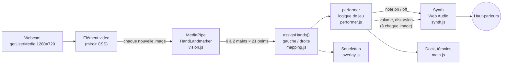
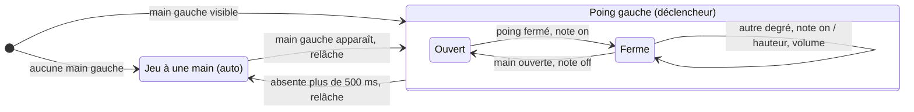
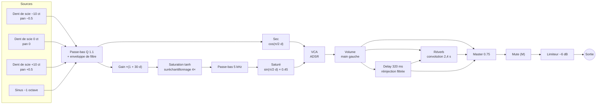

# Fonctionnement

[← Retour au README](../README.md) · [Installation](installation.md) · [Paramètres](parametres.md) · [Dépannage](depannage.md)

Ce document suit une image de la webcam, de la caméra jusqu'au son. Chaque
section indique le fichier concerné. Les valeurs réglables sont toutes
listées dans [Paramètres](parametres.md).

## Vue d'ensemble



Tout tourne dans l'onglet du navigateur. Aucune image ni aucun point de la
main n'est envoyé sur le réseau. Les seules requêtes externes servent à
charger MediaPipe, le modèle et la police au démarrage.

## 1. Démarrage (`main.js`, `vision.js`)

Le clic sur **Démarrer** déclenche, dans l'ordre :

1. `synth.start()` crée l'`AudioContext`. Il doit être créé pendant un geste
   de l'utilisateur, à cause de la politique d'autoplay des navigateurs.
2. `startCamera()` vérifie le contexte sécurisé, puis appelle `getUserMedia`
   (caméra frontale, 1280×720 idéal, sans micro).
3. `createHandTracker()` importe MediaPipe, charge le WASM et le modèle, puis
   crée le `HandLandmarker` sur le **GPU** (WebGL), avec repli automatique sur
   le **CPU**.
4. L'interface passe en mode jeu et la boucle d'image démarre.

Chaque échec renvoie un code (`camera-denied`, `camera-missing`, `insecure`,
`model`…). Il est traduit en un message qui dit quoi faire, et le bouton
devient **Réessayer**.

## 2. Boucle d'image (`main.js` → `loop()`)

La boucle tourne en `requestAnimationFrame`, mais **ne travaille que quand la
caméra a produit une nouvelle image** (`video.currentTime` a changé). Il n'y a
pas d'inférence en double à 120 Hz sur une webcam à 30 images par seconde. À
chaque nouvelle image :

```
detectForVideo(video, now)   → landmarks des mains détectées
assignHands(landmarks)       → { left, right }
perform(hands, now, key)     → événements + état (degré, volume, distorsion…)
synth.noteOn / noteOff       ← pour chaque événement
synth.setVolume / setDrive   ← si la valeur a bougé de plus de 0,5 %
overlay.draw(...)            → squelettes
render(...)                  → dock et témoins (seulement les valeurs qui ont changé)
```

`render()` et `sendIfMoved()` ne touchent au DOM ou à l'audio que si une
valeur a changé. Ça évite de recalculer la mise en page à chaque image et
d'empiler des rampes audio.

## 3. Vision : 21 points par main (`vision.js`)

`HandLandmarker` fonctionne en deux étapes : un détecteur de paume, puis un
modèle qui place **21 points** sur chaque main. Il suit au plus 2 mains, en
mode `VIDEO`, c'est-à-dire avec un suivi d'une image à l'autre.

```
        8   12  16  20        bouts des doigts
        7   11  15  19
        6   10  14  18        articulations PIP
   4    5   9   13  17        bases (MCP)
   3
   2
   1        0                 0 = poignet
```

Les coordonnées sont **normalisées** (`x` et `y` entre 0 et 1) dans l'image
**brute** de la caméra, qui n'est pas en miroir. La vidéo et le canvas sont
retournés en CSS (`transform: scaleX(-1)`), donc on dessine directement dans
ces coordonnées.

### Quelle main est la gauche ? (`assignHands`)

Le label *handedness* de MediaPipe suppose une image déjà en miroir. Sur un
flux webcam brut, il se trompe. On répartit donc les mains selon leur **côté
à l'écran** : `x_écran = 1 − x`. La main à droite de l'écran est la main
droite de l'utilisateur. S'il n'y a qu'une main, elle est classée selon la
moitié de l'écran où elle se trouve.

## 4. Gestes (`mapping.js`)

Ce sont toutes des fonctions pures et testées.

### Doigts tendus (`fingerStates`)

Un doigt est **tendu** si son bout est nettement plus loin du poignet que son
articulation PIP :

```
distance(poignet, bout) > distance(poignet, PIP) × 1,1
```

Cette règle compare des **distances**, pas des positions verticales. Elle
fonctionne donc aussi quand la main est inclinée (testé à ±60°). C'est ce
qui permet de tourner le poignet pour la distorsion sans changer de note.
gesture-synth, à l'inverse, compare `tip.y < pip.y`, ce qui échoue dès que la
main penche.

Le **pouce** est jugé à part. Il est tendu si son bout est loin de la base du
majeur (point 9), rapporté à la largeur de la paume :

```
distance(bout du pouce, point 9) > largeur de paume (5 ↔ 17) × 0,9
```

### Degré (`degreeFromFingers`), option R3

| Forme | Degré |
|---|---|
| Index et auriculaire seuls | VI |
| Index, auriculaire et pouce | VII |
| Sinon, 1 à 5 doigts tendus (pouce compris) | I à V |
| Poing (0 doigt) | aucune note |

Les formes spéciales sont testées **avant** le comptage, parce qu'elles ont
aussi 2 et 3 doigts.

### Stabilisation (`createStabilizer`)

Passer de 1 à 4 doigts traverse forcément 2 et 3. Pour qu'un degré soit
validé, il doit rester identique pendant **90 ms**. Les formes de passage ne
sont jamais jouées.

### Poing (`createFistDetector`)

Le pouce est ignoré. Les règles, avec hystérésis :

- **fermé** quand aucun des 4 doigts n'est tendu ;
- **ouvert** dès que 2 doigts ou plus sont tendus ;
- avec exactement 1 doigt tendu, l'état précédent est conservé, ce qui évite
  les rebonds sur une main à moitié fermée.

### Rotation du poignet (`handRoll`, `driveFromRoll`)

L'angle est celui de l'axe **poignet (0) → base du majeur (9)** par rapport
à la verticale. Cet axe ne bouge pas quand on tend ou replie les doigts.

```
angle = atan2(x9 − x0, y0 − y9)                    (0° = main verticale)
distorsion = clamp((|angle| − 15°) / (60° − 15°), 0, 1)
```

La distorsion marche dans les deux sens de rotation, avec une zone morte de
15° (une main naturellement tenue n'est jamais parfaitement droite). Elle est
lissée (α = 0,3) contre le tremblement du tracking.

### Hauteur de la main gauche

La hauteur est lue sur le point 9, dans une zone qui va de `y = 0,85` (bas,
valeur 0) à `y = 0,15` (haut, valeur 1) :

- **volume** = la hauteur, lue **en continu tant que le poing est fermé** et
  lissée (α = 0,35). À chaque nouvel appui, le lissage repart de la valeur
  réelle pour éviter un fondu depuis l'ancien volume ;
- **vélocité** = 0,25 + 0,75 × la hauteur, lue **une seule fois au moment de
  l'appui**. Elle ne règle que la brillance de l'attaque.

## 5. Logique de jeu (`performer.js`)

`createPerformer()` renvoie une fonction `step(mains, temps, tonalité)`,
appelée à chaque image. Elle ne touche ni au DOM ni à l'audio : elle renvoie
des **événements** (`on` / `off`) et un **état** (degré choisi, note jouée,
volume, distorsion, doigts…). C'est ce qui la rend testable avec des mains
synthétiques.



**Avec la main gauche (déclencheur).**
- **Ouvert → fermé** : la note du degré choisi part (note on), avec la
  vélocité lue à ce moment-là.
- **Poing fermé, degré qui change** : la nouvelle note part sans relâche.
- **Poing fermé avant d'avoir choisi** : l'appui est mémorisé, et la note
  part dès que la main droite forme un degré.
- **Main qui arrive déjà fermée** dans l'image : rien ne se joue tant qu'elle
  ne s'est pas ouverte puis refermée.
- **Main perdue moins de 500 ms** (flou de bougé en glissant) : la note
  tient.

**Sans main gauche (auto).**
- Chaque degré stable joue sa note, avec un volume et une vélocité fixes de
  0,8.
- Un poing droit (0 doigt) relâche la note.
- Juste après la disparition de la main gauche, le degré déjà formé n'est
  **pas** rejoué d'office : il faut changer de doigts.

## 6. De la note à la fréquence (`mapping.js`)

```
MIDI      = 12 × (octave + 1) + tonique + gamme[degré − 1]
fréquence = 440 × 2^((MIDI − 69) / 12)          (tempérament égal, La = 440 Hz)
```

Les gammes sont des intervalles en demi-tons depuis la tonique :

| Gamme | Intervalles | Exemple en Do, octave 3 |
|---|---|---|
| Majeure | 0 2 4 5 7 9 11 | C3 D3 E3 F3 G3 A3 B3 (131 → 247 Hz) |
| Mineure naturelle | 0 2 3 5 7 8 10 | C3 D3 D#3 F3 G3 G#3 A#3 |

## 7. Moteur audio (`synth.js`)

Le synthé est **monophonique** (une note à la fois), avec un son épais. Le
graphe est construit une seule fois. Les oscillateurs tournent en
permanence, et ce sont les enveloppes qui ouvrent et ferment le son. Comme
rien n'est arrêté ni recréé, il n'y a pas de clic.



*d* est la distorsion, de 0 à 1 (rotation du poignet droit).

### Ce qui se passe à chaque note (`noteOn`)

1. **Hauteur** : les 4 oscillateurs glissent vers la nouvelle fréquence en
   quelques millisecondes (`glide`). Ça évite les sauts secs sans s'entendre
   comme un portamento.
2. **ADSR d'amplitude** : le niveau part **de sa valeur actuelle**
   (`cancelAndHoldAtTime`, avec un équivalent pour Firefox). Il monte au pic
   en 15 ms, puis descend vers 65 % en environ 250 ms. Rejouer une note qui
   sonne déjà ne fait donc pas de clic.
3. **Enveloppe de filtre (« pluck »)** : la coupure monte en 8 ms jusqu'à
   `base + vélocité × 5500 Hz`, puis redescend vers
   `base + vélocité × 900 Hz` en environ 350 ms. La base suit la note
   (`250 + 0,8 × fréquence`), pour que les notes graves ne soient pas plus
   sombres que les aiguës.

`noteOff` ramène le VCA à 0 et le filtre à sa base en environ 300 ms
(relâchement).

### Contrôles continus

- **`setVolume(v)`** : de 0 à 1, sur une échelle en décibels (−30 dB → 0 dB,
  silence en dessous de 1 %), lissé en environ 40 ms. Il agit **après**
  l'enveloppe, donc il peut varier pendant que la note est tenue.
- **`setDrive(d)`** : mélange à **puissance constante** entre le signal sec
  et le signal saturé. Le gain avant la saturation monte jusqu'à ×31. Le
  passe-bas à 5 kHz retire l'aigreur.

### Effets

| Préréglage (interface) | Réverb | Delay |
|---|---|---|
| Sec | 0 | 0 |
| Réverb (par défaut) | 25 % | 0 |
| Réverb et delay | 25 % | 18 % |

La **réverb** est un `ConvolverNode` nourri d'une réponse impulsionnelle
**générée au démarrage** : un bruit stéréo qui décroît de 60 dB en 2,4 s et
s'assombrit avec le temps. Il n'y a aucun fichier à charger. Le **delay**
réinjecte sa sortie à travers un passe-bas, donc chaque répétition est plus
sombre. Il alimente aussi la réverb.

## 8. Interface (`index.html`, `styles.css`, `main.js`, `overlay.js`)

- La **vidéo occupe tout l'écran**. Les éléments en verre flottent
  par-dessus et sont les seuls à capter les clics.
- Le **dock** contient la note, les 7 degrés et les doigts à lever pour
  chacun. Le degré choisi a un contour jaune, et celui qui sonne devient une
  touche jaune pleine. Il affiche aussi les doigts détectés, le volume et la
  distorsion.
- La **superposition** (`overlay.js`) dessine le squelette droit en jaune,
  avec un anneau au bout des doigts tendus et un arc de rotation quand la
  distorsion est active. Le squelette gauche est en cobalt, avec un disque
  plein sur la paume quand le poing est fermé.
- Les **réglages** s'ouvrent dans une fenêtre en verre (bouton en haut à
  droite, Échap pour fermer). Les contrôles sont des boutons radio natifs.

Le détail visuel (matériau verre, tokens, composants) est dans le
[design system](design-system.md).

## 9. Cycle de vie et robustesse

| Situation | Comportement |
|---|---|
| Onglet masqué | La note est relâchée et la logique de jeu repart de zéro (`requestAnimationFrame` s'arrête) |
| Caméra débranchée | Même chose, plus un retour à l'accueil avec le message « Rebranche-la… » et le bouton Réessayer |
| Pas de `backdrop-filter`, ou transparence réduite demandée | Le verre devient presque opaque |
| `prefers-reduced-motion` | Les transitions sont coupées |
| Pas de GPU utilisable | MediaPipe passe sur le CPU |

## 10. Latence

| Étape | Ordre de grandeur |
|---|---|
| Image webcam (30 images par seconde) | ~33 ms entre deux images |
| Inférence MediaPipe (GPU) | ~5–20 ms selon la machine |
| Poing → note on | Pas de délai ajouté |
| Changement de doigts → nouvelle note | +90 ms (stabilisation) |
| Sortie audio (`latencyHint: "interactive"`) | ~10–30 ms selon le système |

Pour un jeu rythmé, il vaut mieux **choisir la note d'abord avec la main
droite, puis frapper avec le poing**. Le poing est le chemin le plus rapide.
